# Explanation Slides — End-to-End Mermaid Diagrams

Diagram source for the 4-hour MCP workshop deck (`Training Process.pptx`, 48 slides).

**How to use this file**
- Each entry maps to a slide (or a suggested *new* insert) and contains: what participant confusion it fixes, the diagram type, a ready-to-render **mermaid** block, and a one-line caption.
- Render each block at [mermaid.live](https://mermaid.live) → export PNG/SVG → enhance with the image model → paste into the slide.
- Only `flowchart` and `sequenceDiagram` are used so everything renders cleanly and shares one visual language.

**Single running thread (kept consistent across all diagrams)**
- **Concept slides:** "Why is Branch-12 / Webex slow?" network-troubleshooting story (Webex · ThousandEyes · Splunk), matching the deck's existing slides 9/11/16/19/21.
- **Protocol + lab slides:** the *real* workshop server — LibreChat → MCP server (`:8000/mcp`, bearer) → Netmiko SSH → **Router1 `172.18.2.6`**, tools `get_interfaces` / `dynamic_show` / `configure_interface` / `create_loopback`, resources `router://interfaces|running-config|baseline`, prompts `/troubleshoot_interface` · `/audit_router_config`, plus the elicitation confirm-gate.

**Legend (reuse these role labels everywhere for a coherent look)**
- **Host** = the AI app the user talks to (LibreChat, Claude Desktop, Cursor)
- **Client** = the MCP connector inside the host (1 client ↔ 1 server)
- **Server** = the program exposing Tools / Resources / Prompts (our router server)
- **LLM** = the model doing the reasoning
- **Router1** = the lab device the server drives over SSH

---

## A. Concept glue

### Slide 14 — How APIs Work (request/response cycle)
**Fixes:** the current slide is overlapping text with no picture; participants don't see the request→process→response loop.
**Type:** sequenceDiagram

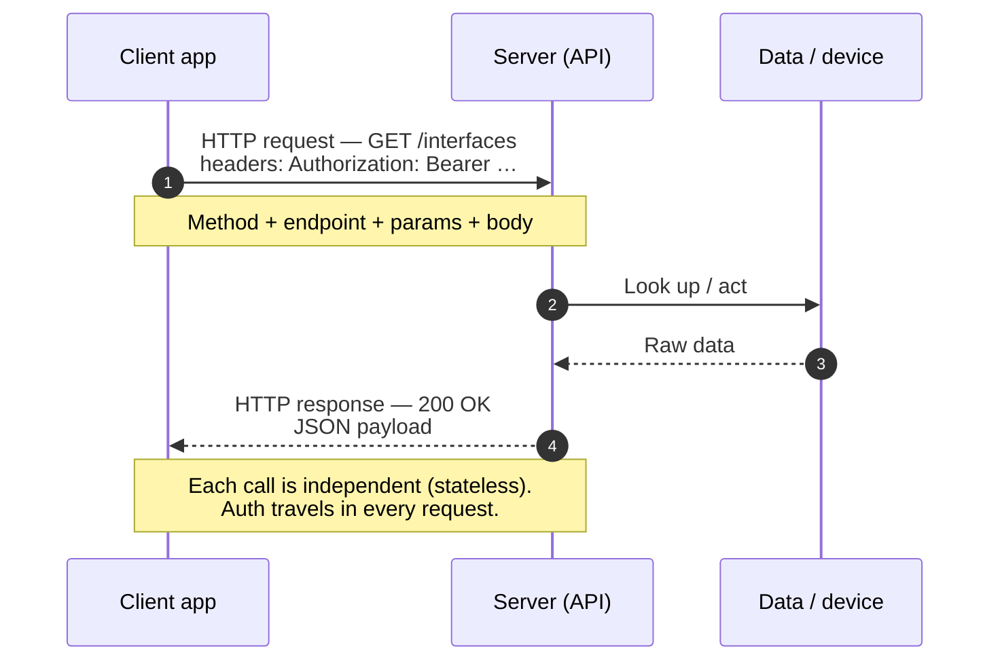
*Caption: An API call is one round trip — the client asks with a verb + endpoint, the server does the work and answers with a status code and JSON. Every call stands alone.*

---

### Slide 17 / 18 — The M×N Integration Problem
**Fixes:** text-only "N×M problem"; participants can't see why custom integrations explode.
**Type:** flowchart (bipartite)

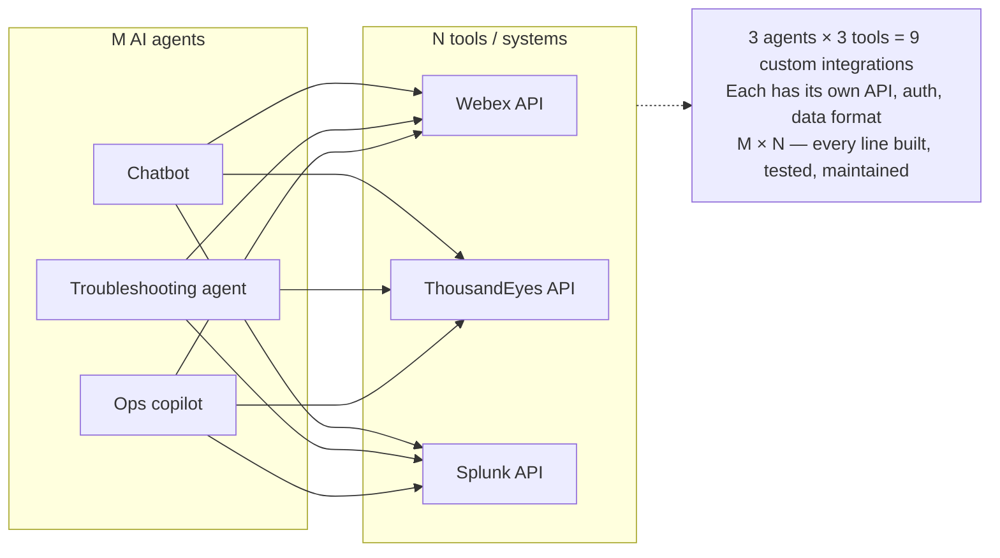
*Caption: Without a standard, every agent needs bespoke glue for every system. 3×3 already = 9 brittle integrations; it grows as M×N.*

---

### Slide 18 / 19 — The MCP Solution: M + N
**Fixes:** broken side-by-side text; the "linear scaling" payoff isn't visual.
**Type:** flowchart (hub)

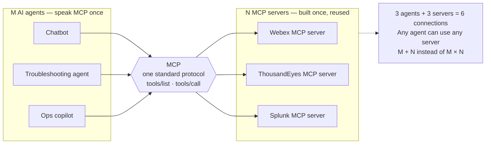
*Caption: Each agent implements MCP once; each system is wrapped once as an MCP server. 5×10 = 50 custom integrations becomes 5+10 = 15.*

---

### NEW 18a — MCP Value Proposition (who maintains the integration?)
**Fixes:** meet-notes ask — show how *vendor-provided* MCP servers remove the API-churn burden. Kept on-thread with a network vendor (Splunk) instead of booking.com.
**Type:** flowchart (before / after)

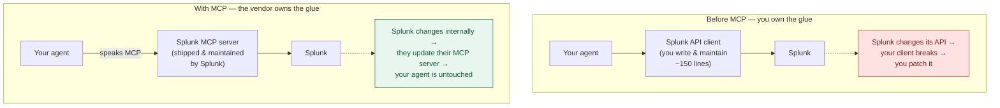
*Caption: When a provider ships its own MCP server, API changes are their problem, not yours. Your agent speaks one protocol and stops chasing breaking integrations.*

---

### Slide 20 — What is MCP? ("USB-C for AI")
**Fixes:** broken/overlapping text; the analogy never lands visually.
**Type:** flowchart (analogy, two parallel rows)

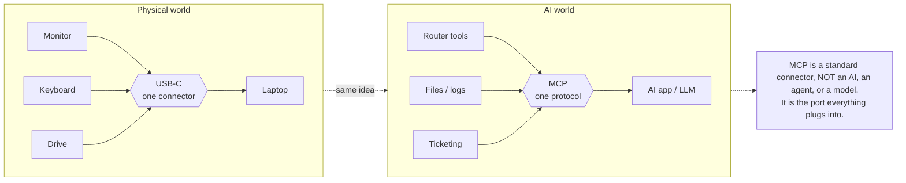
*Caption: USB-C let any device use one port. MCP lets any tool plug into any AI the same way — it's the connector, not the brain.*

---

## B. Architecture / protocol

### Slide 23 — MCP Protocol Architecture (Host / Client / Server + layers)
**Fixes:** the core meet-notes request — participants can't picture host vs client vs server, or the data/transport split.
**Type:** flowchart (component diagram with subgraphs)

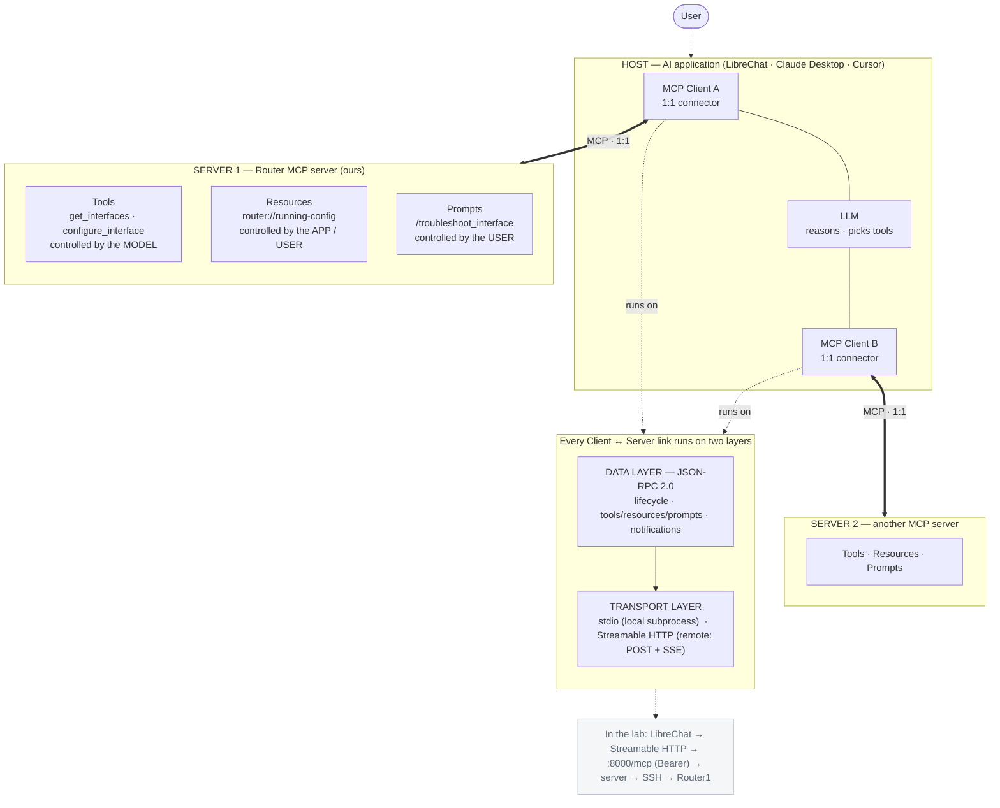
*Caption: The Host runs the LLM plus one Client per Server (1:1). Each Server exposes Tools (model-controlled), Resources & Prompts (app/user-controlled). Every link rides the same two layers — JSON-RPC (data) over stdio or Streamable HTTP (transport); our lab uses HTTP.*

> **Deck build note:** in `Training Process.pptx` this slide is drawn as **native PowerPoint shapes** (deck theme: navy/cyan slate, Noto Sans), not the mermaid image above. Regenerate with `python3 scripts/redraw_arch_diagram.py`. The mermaid above is kept as the editable spec.

---

### Slide 26 — JSON-RPC 2.0 Message Types
**Fixes:** slide shows a notification blob only; participants don't see how request/response/notification differ (the `id` correlation).
**Type:** sequenceDiagram

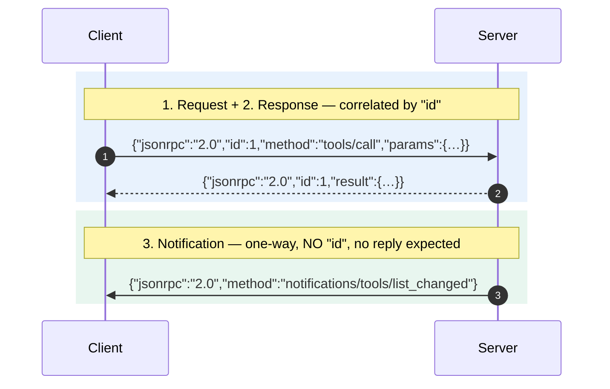
*Caption: Requests carry an `id`; the matching response echoes it. Notifications drop the `id` entirely — fire-and-forget, used for live updates.*

---

### Slide 27 — Transport Mechanisms (stdio vs Streamable HTTP)
**Fixes:** overlapping text; participants don't see local vs remote, or which one the lab uses.
**Type:** flowchart (two variants)

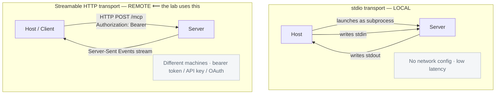
*Caption: stdio = server runs as a local subprocess (I/O over pipes). Streamable HTTP = client and server on different machines, POST + SSE, authenticated. Our workshop server runs HTTP at `:8000/mcp` with a bearer token.*

---

### Slide 28 / 29 — MCP Protocol Lifecycle (all 4 phases)
**Fixes:** the four phases are separate cards; participants don't see them as one ordered conversation.
**Type:** sequenceDiagram

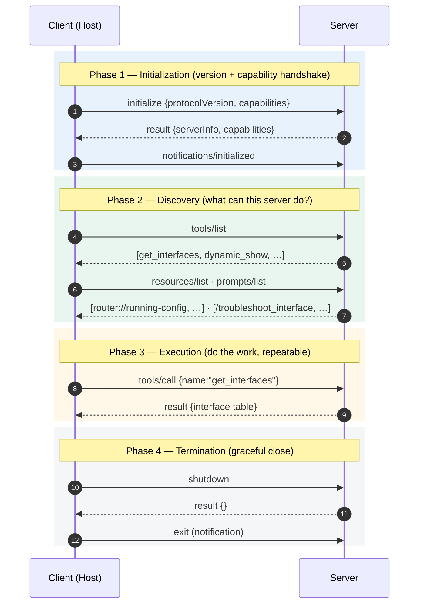
*Caption: One session, four phases — shake hands, discover capabilities, call them as needed, then close cleanly.*

---

## C. The six primitives

### NEW 30a / Slide 30–31 — Six primitives, three control points
**Fixes:** the "overall picture" for primitives — who is actually in control of each, mapped to the lab.
**Type:** flowchart (grouped by controller)

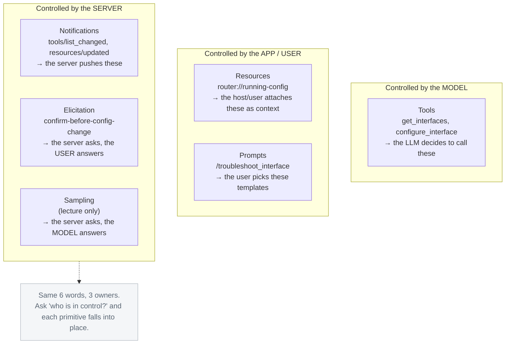
*Caption: Six primitives sort into three control points — the model calls Tools; the app/user supplies Resources & Prompts; the server drives Notifications, Elicitation, and Sampling.*

---

### Slide 32 / 33 — Tools (discovery → invocation → validation → result)
**Fixes:** slide shows JSON only; the call flow (who validates, when) isn't drawn.
**Type:** sequenceDiagram

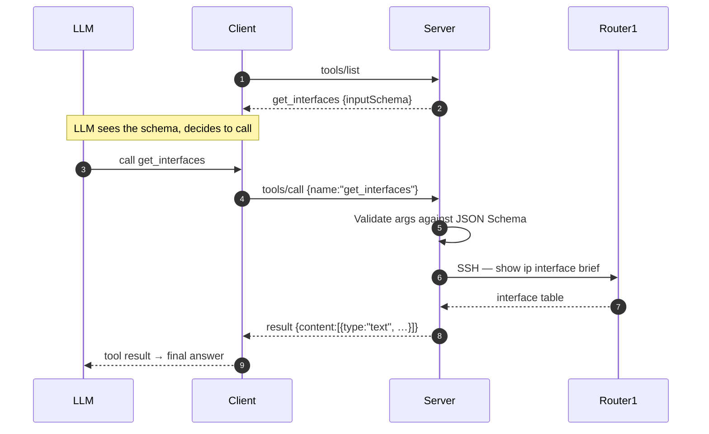
*Caption: The model discovers a tool's schema, calls it, the server validates the inputs, runs the action, and returns a structured result the model reads.*

---

### Slide 34 — Tools: FastMCP mapping (the docstring IS the prompt)
**Fixes:** participants miss that the Python function *becomes* the tool contract.
**Type:** flowchart (mapping)

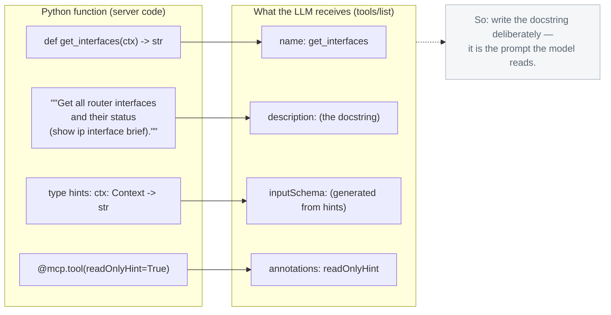
*Caption: FastMCP turns the function name into the tool name, the docstring into the description the LLM reads, and the type hints into the JSON Schema. The docstring is prompt engineering.*

---

### Slide 35 / 36 — Resources (app-controlled context + subscriptions)
**Fixes:** slide shows read JSON only; the list/read/subscribe/update lifecycle isn't drawn.
**Type:** sequenceDiagram

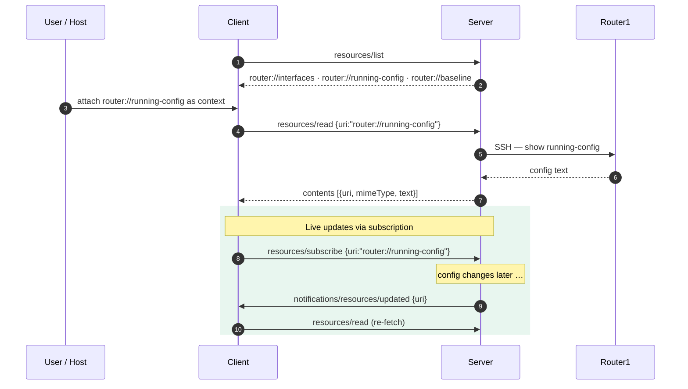
*Caption: Resources are read-only context the app/user chooses to attach. Subscribe once and the server notifies the client whenever that resource changes.*

---

### Slide 37 / 38 — Prompts (user-controlled templates)
**Fixes:** slide shows JSON; participants don't see prompts as user-triggered, parameterized templates.
**Type:** sequenceDiagram

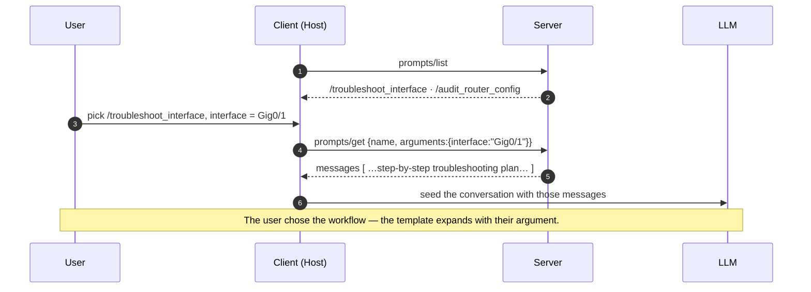
*Caption: Prompts are reusable, parameterized templates the user invokes (like a slash command). The server fills in the arguments and returns ready-to-run messages.*

---

### Slide 39 — Elicitation (server asks, user answers) + graceful degrade
**Fixes:** participants confuse elicitation with prompts; and don't know what happens on clients (LibreChat) that lack the capability.
**Type:** sequenceDiagram

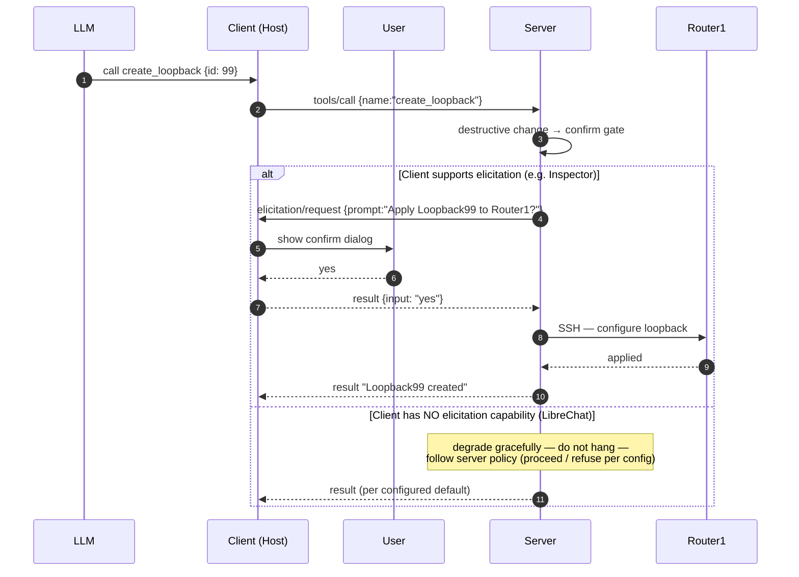
*Caption: Elicitation lets the server pause mid-tool to ask the user a question. Clients without the capability don't break — the server degrades gracefully instead of hanging.*

---

### Slide 40 — Notifications (server-controlled, one-way)
**Fixes:** participants don't see what triggers each notification in the real server.
**Type:** sequenceDiagram

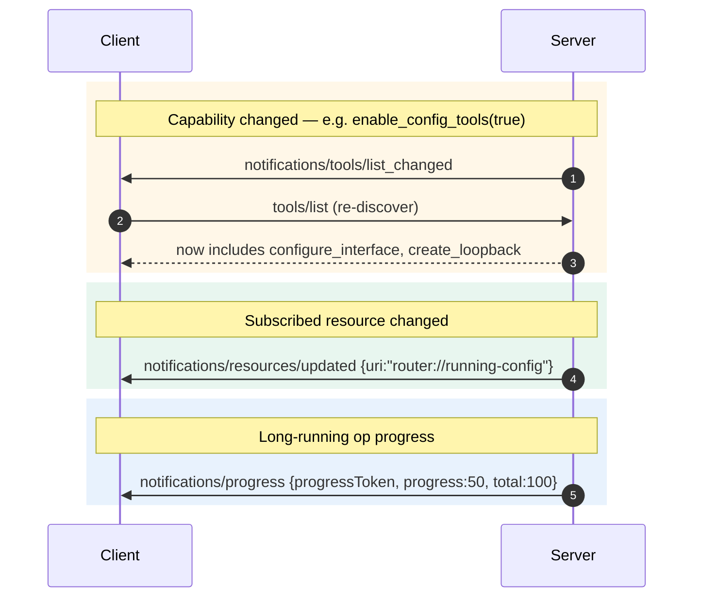
*Caption: Notifications are one-way pushes from server to client — new tools appeared, a resource changed, or work is progressing. No `id`, no reply.*

---

### NEW 40a — Sampling (lecture only: server asks, model answers)
**Fixes:** rounds out the six primitives; sampling is easy to confuse with tools.
**Type:** sequenceDiagram

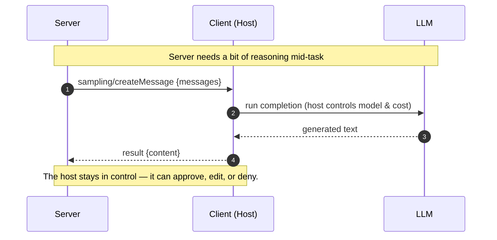
*Caption: Sampling flips the direction — the server asks the client's model to think. The host mediates, so it keeps control of cost and safety. (Lecture only; not consumed by the lab client.)*

---

## D. The lab + end-to-end flow (the biggest gap)

### NEW Big-Picture — one Client, one Server, one Router (high-level overview)
**Fixes:** participants need the simplest possible mental model first — before the detailed topology. One client desktop, one server desktop, one router, two hops.
**Type:** native pptx shapes (deck theme), grounded in `mcp-workshop-topo.png`.

> **Deck build note:** this slide is drawn as **native PowerPoint shapes** (no mermaid), placed just before the detailed Lab-Topo slide. Regenerate with `python3 scripts/draw_bigpicture_slide.py`.

Flow it shows:
`MCP-Client desktop (172.18.0.2) — Host app: LibreChat → MCP Client`  →  **MCP · Streamable HTTP · :8000/mcp · Bearer** (across the lab network: public-internet2 → switch)  →  `MCP-Server desktop (172.18.1.2) — MCP server script (FastMCP) → Tools`  →  **Netmiko SSH · show/config**  →  `Router1 (172.18.2.6) — Cisco IOS`.

One-liner (footnote on the slide): *you ask LibreChat → its MCP client calls the server over MCP → the server's tools SSH into Router1 → the answer comes back to you.*

---

### NEW Lab-Topo — Workshop lab topology
**Fixes:** meet-notes core ask — participants need to see the sandbox: what runs where, ports, auth, and the SSH boundary to the router.
**Type:** flowchart (topology with subgraphs)

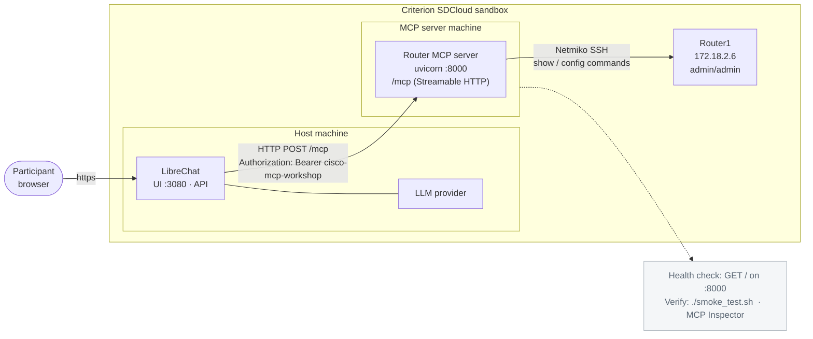
*Caption: The whole lab in one picture — your browser → LibreChat (:3080) → MCP server (:8000/mcp, bearer token) → SSH → Router1. LibreChat is the MCP host/client; the server drives the real device.*

---

### NEW Lab-E2E — End-to-end query flow ("show me the interfaces")
**Fixes:** THE money diagram — participants finally see how one typed question becomes a tool call, an SSH command, and an answer. Ties every component together.
**Type:** sequenceDiagram

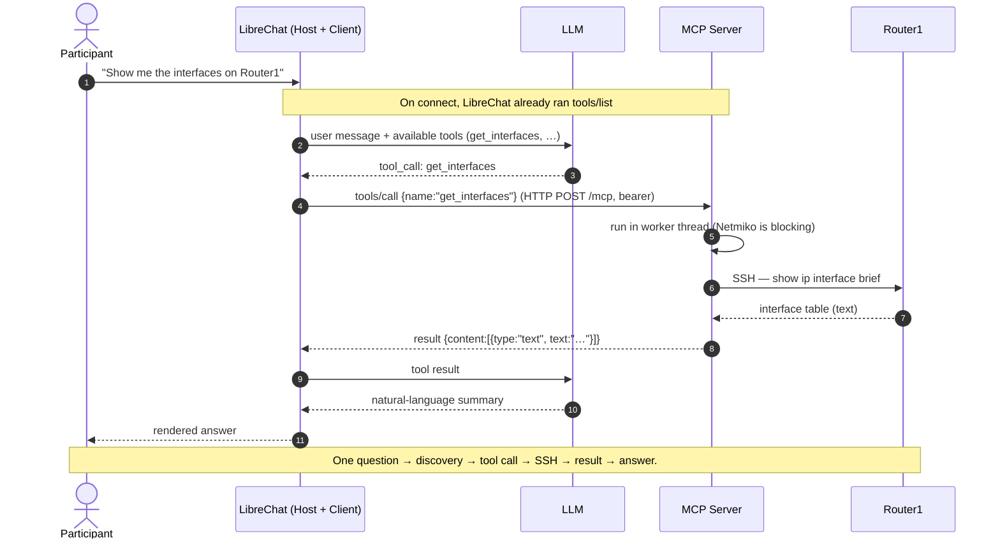
*Caption: A single question travels: LibreChat gives the LLM the tool list, the LLM picks `get_interfaces`, LibreChat calls the server, the server SSHes to Router1, and the result flows back as a plain-English answer.*

---

### NEW Lab-Config — Config change with the safety gate (rollback-aware)
**Fixes:** shows the production-safe pattern — confirm before change, snapshot for rollback, notify after. This is the destructive-tool story.
**Type:** sequenceDiagram

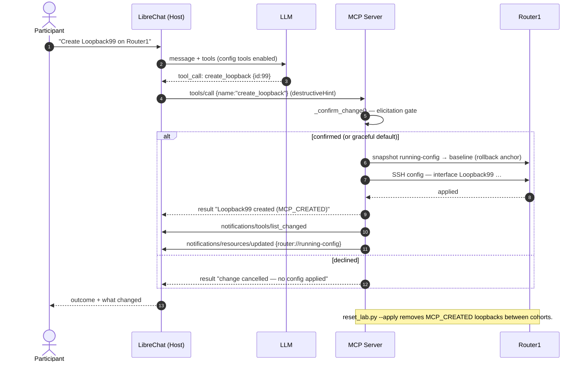
*Caption: Config-writing tools are gated: confirm first, snapshot a rollback baseline, apply, then push notifications so the client re-discovers state. Safe-by-default, auditable, reversible.*

---

### NEW Inspector — What the MCP Inspector shows (end-of-session debugger)
**Fixes:** the Inspector is demoed last; a simple map of its tabs orients participants to what they're seeing.
**Type:** flowchart

```mermaid
flowchart LR
    insp["MCP Inspector<br/>(npx @modelcontextprotocol/inspector)"]
    insp -->|"Streamable HTTP<br/>http://server:8000/mcp<br/>Bearer token"| srv["Router MCP server"]

    subgraph Tabs["What you can inspect"]
        t1["Tools — list & call<br/>get_interfaces, dynamic_show, …"]
        t2["Resources — browse & read<br/>router://running-config"]
        t3["Prompts — expand templates<br/>/troubleshoot_interface"]
        t4["Notifications — watch live<br/>list_changed, updated"]
    end

    srv --- Tabs
    note["Same protocol as LibreChat, but raw —<br/>you see the actual JSON-RPC on the wire."]:::muted
    Tabs -.-> note
    classDef muted fill:#f4f6f8,stroke:#b0b8c0,color:#5a6673;
```
*Caption: The Inspector connects to the same `/mcp` endpoint and exposes each primitive on its own tab — the clearest way to watch the raw JSON-RPC once you understand the flow.*

---

## Placement summary (where the new inserts go)

| New diagram | Suggested placement |
|---|---|
| **18a** Value proposition | after slide 19 (MCP M+N solution) |
| **30a** Six primitives / three control points | at slide 30–31 (replaces/augments the primitives intro) |
| **40a** Sampling | after slide 40 (notifications), before SDK section |
| **Lab-Topo** | start of the lab section (after slide 44/45 SDK, before hands-on) |
| **Lab-E2E** | immediately after Lab-Topo — the anchor diagram for the whole workshop |
| **Lab-Config** | after Lab-E2E, when introducing config tools / Lab 5 |
| **Inspector** | end of session, with the Inspector demo |

## Existing slides intentionally left as-is (already have a good diagram)
7, 8, 9, 11, 16, 19, 21, 24, 44, 45 — these render clearly today; only fix layout/text overflow, no new mermaid needed.
